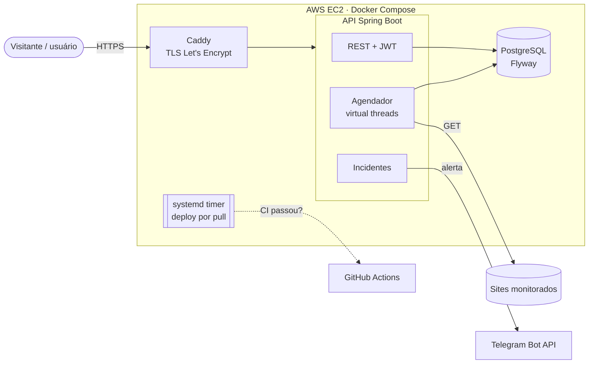
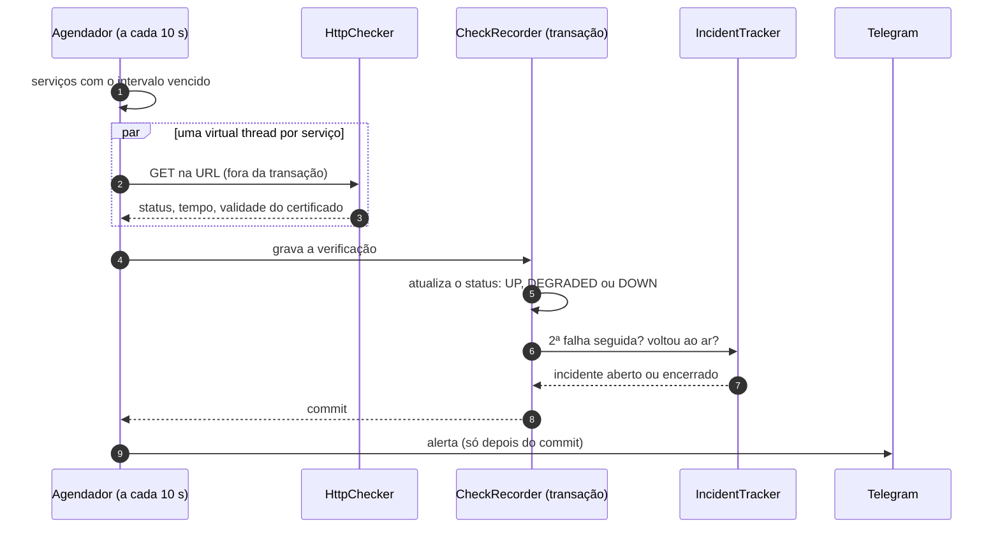
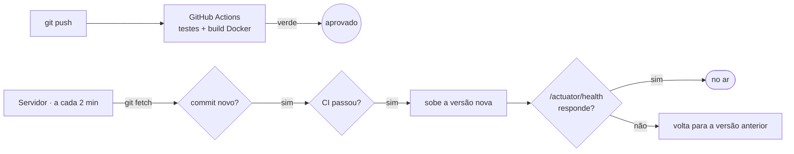

# Vigia

[](https://github.com/DaviCastroDCC/vigia/actions/workflows/ci.yml)


Monitor de disponibilidade de sites e APIs, com página de status pública, incidentes e alertas no Telegram.

**🔗 Demonstração ao vivo: [vigia-status.duckdns.org](https://vigia-status.duckdns.org)**: o badge de uptime acima é gerado pelo próprio Vigia, monitorando a si mesmo.

A cada minuto o Vigia verifica cada URL cadastrada, guarda o status e o tempo de resposta e calcula o uptime. Quando um serviço cai, abre um incidente e avisa o dono no Telegram; quando volta, avisa de novo com o tempo que ficou fora.

## Destaques

- **Verificações em paralelo com virtual threads** (Java 21): um site lento não atrasa os outros.
- **Três estados**: no ar, **lento** (acima de um limite por serviço) e fora do ar.
- **Incidentes** com início, fim, duração e causa, abertos só depois de 2 falhas seguidas, para não gerar alarme falso.
- **Alertas no Telegram**: conexão por link de uso único, sem copiar ID nenhum.
- **Página de status pública**: barra de 90 dias, gráfico de resposta, validade do certificado SSL e incidentes recentes.
- **Badge de uptime em SVG** para qualquer README.
- **Seguro para cadastro aberto**: proteção contra SSRF, vitrine que impede publicação de terceiros, limite de serviços por conta e de tentativas de login.
- **CI/CD**: testes a cada push, e o servidor publica sozinho as versões aprovadas, com **rollback automático**.

## Arquitetura



### O caminho de uma verificação



## Decisões de engenharia

| Decisão | Por quê |
|---|---|
| **Virtual threads** em vez de um pool fixo | A verificação passa quase todo o tempo esperando a rede. Cada serviço ganha a própria thread sem custo, e um site que demora 10 s não segura os outros. |
| **Requisição HTTP fora da transação** | Dentro dela, uma requisição lenta seguraria uma conexão do banco pelo mesmo tempo. |
| **Incidente só após 2 falhas seguidas** | Uma falha isolada costuma ser oscilação de rede. Alarme falso faz as pessoas ignorarem os alertas. |
| **Alerta só depois do commit** | Nunca avisar sobre algo que não ficou salvo. |
| **Bloqueio de endereços internos (SSRF)** e não seguir redirecionamentos | Qualquer pessoa cadastra uma URL e o servidor faz a requisição. Sem o bloqueio, alguém poderia ler `169.254.169.254`, o endpoint de metadados da AWS, que expõe credenciais da instância. |
| **Vitrine** (só uma conta publica) | Com cadastro aberto, sem isso qualquer pessoa poderia colocar spam na página de status. A regra vale no servidor, não só na tela. |
| **Resumo de 90 dias em cache por 3 min** | A página atualiza a cada 15 s por visitante, e reagregar 90 dias de verificações a cada atualização seria desperdício. |
| **Validade do certificado lida da própria conexão TLS** | Não precisa de uma segunda requisição. |
| **Telegram por `getUpdates` (polling)** | Dispensa expor um webhook público. O link `t.me/bot?start=<código>` associa o chat à conta sem o usuário copiar ID. |
| **Deploy por pull**, e não por SSH a partir do GitHub | A porta 22 continua fechada para a internet e nenhuma chave do servidor fica no GitHub. |

## Estudo de caso: o monitor medindo a própria lentidão

Os gráficos mostravam picos de ~1 s **em todos os serviços ao mesmo tempo** (AWS, GitHub, Google, Wikipedia e Cloudflare). Seria coincidência demais todos ficarem lentos juntos, então a causa estava do nosso lado.

| Hipótese | O que os dados mostraram |
|---|---|
| Conexão nova a cada verificação | ❌ O `HttpClient` já era único e reaproveitava conexões (keep-alive). |
| Todas as verificações disparando juntas | ❌ Em funcionamento normal, as 6 disparavam juntas e ficavam em ~100 ms. |
| Pausa de GC ou cache de DNS | ❌ Os picos apareceriam a qualquer hora, não só em alguns minutos. |
| **Partida a frio após o deploy** | ✅ Os 5 picos coincidiam **exatamente** com os 5 reinícios da API. |

Logo depois de subir, a JVM ainda não otimizou (JIT) o código de TLS e não existe nenhuma conexão aberta, então a primeira requisição a cada site é bem mais lenta. A correção foi uma **rodada de aquecimento descartada** antes da primeira medição:

| Primeira verificação após um deploy | Antes | Depois |
|---|---|---|
| Cloudflare | ~1060 ms | 255 ms |
| GitHub | ~1050 ms | 111 ms |
| AWS | ~890 ms | 235 ms |
| Google | ~740 ms | 111 ms |
| Wikipedia | ~750 ms | 29 ms |

## Funcionalidades

### Página de status

Sem login, mostra os serviços da vitrine: status **online** (verde), **lento** (amarelo) ou **fora do ar** (vermelho); uptime de 24 h e de 90 dias; tempo médio de resposta; dias até o certificado SSL vencer (em destaque quando faltam menos de 14); as últimas 60 verificações; o gráfico do tempo de resposta e os incidentes recentes. A página se atualiza sozinha a cada 15 s.

### Painel

Depois do login, cada usuário cadastra, verifica e exclui os próprios serviços, define o limite de "lento", copia o Markdown do badge de uptime e conecta o Telegram.

### Vitrine e privacidade entre usuários

O cadastro é aberto. Para isso ser seguro numa página pública:

| | Página pública (sem login) | Painel (logado) |
|---|---|---|
| **Dono da vitrine** (`SHOWCASE_OWNER_EMAIL`) | Mostra os serviços que ele marca como públicos | Todos os seus serviços, com a opção "Público", sem limite de quantidade |
| **Demais usuários** | Veem a vitrine | Os próprios serviços (até 5, editáveis) e, abaixo, a vitrine (só leitura) |

Os serviços dos demais usuários **nunca** aparecem para outras pessoas: o pedido de "público" de quem não é dono da vitrine é ignorado pelo servidor. Sem `SHOWCASE_OWNER_EMAIL` (uso local), qualquer serviço marcado como público aparece.

### Alertas no Telegram

**Conectar Telegram** gera um link `t.me/<bot>?start=<código>` de uso único. Ao tocar em **Iniciar**, o Telegram envia `/start <código>` ao bot; o Vigia encontra a conta pelo código e passa a mandar os alertas para aquele chat:

> 🔴 **GitHub** está fora do ar · Causa: HTTP 503 · Desde 06/11 14:02
>
> 🟢 **GitHub** voltou ao ar · Ficou fora por 7 min

## Rodando localmente

```bash
cp .env.example .env          # e troque os valores
docker compose up -d --build  # API + PostgreSQL em http://localhost:8080
```

Sem Docker, com um PostgreSQL local: `mvn spring-boot:run` (a conexão é configurada pelas variáveis do `.env.example`).

### Testes

```bash
mvn verify
```

São **20 testes** de unidade e de integração. Usam H2 em memória e um servidor HTTP falso, que simula site no ar, fora do ar, lento e instável, então não precisam de rede nem de Docker. O CI roda os mesmos testes e o build da imagem Docker a cada push.

## API

Todas as rotas `/api/services/**` e `/api/me/**` exigem `Authorization: Bearer <token>`. Erros seguem o formato [RFC 7807](https://www.rfc-editor.org/rfc/rfc7807) (`application/problem+json`).

| Método | Rota | Descrição |
|---|---|---|
| POST | `/api/auth/register` | Cria a conta e devolve o token |
| POST | `/api/auth/login` | Devolve o token |
| GET | `/api/services` | Seus serviços com o último status |
| POST | `/api/services` | Cadastra um serviço |
| GET · PUT · DELETE | `/api/services/{id}` | Detalhe, atualização e remoção (com o histórico) |
| POST | `/api/services/{id}/check` | Verifica agora, sem esperar o agendador |
| GET | `/api/services/{id}/checks?page=0&size=50` | Histórico, do mais recente ao mais antigo |
| GET | `/api/services/{id}/uptime?hours=24` | Uptime em % e tempo médio de resposta |
| GET | `/api/services/dashboard` | Seus serviços e a vitrine, com uptime, 90 dias, gráfico e incidentes |
| GET | `/api/public/status` | A vitrine, sem login |
| GET | `/api/public/services/{id}/badge.svg?days=30` | Badge SVG de uptime |
| GET | `/api/me` | Dados da conta, Telegram e limites |
| POST · DELETE | `/api/me/telegram` | Gera o link de conexão / desconecta o Telegram |
| GET | `/actuator/health` | Health check da própria API |

Documentação interativa (Swagger UI) em `/swagger-ui.html`.

```bash
TOKEN=$(curl -s -X POST localhost:8080/api/auth/register -H 'Content-Type: application/json' \
  -d '{"name":"Usuario","email":"usuario@exemplo.com","password":"sua-senha"}' | jq -r .token)

curl -s -X POST localhost:8080/api/services -H "Authorization: Bearer $TOKEN" \
  -H 'Content-Type: application/json' -d '{"name":"GitHub","url":"https://github.com","intervalSeconds":60}'

curl -s "localhost:8080/api/services/1/uptime?hours=24" -H "Authorization: Bearer $TOKEN"
# {"serviceId":1,"periodHours":24,"totalChecks":1440,"upChecks":1438,"uptimePercent":99.86,"avgResponseTimeMs":212.4}
```

## Segurança

- **Credenciais só em variáveis de ambiente** (banco, segredo do JWT, token do bot); o `.env` real nunca vai para o repositório e o token do bot nunca aparece em log.
- **SSRF**: URLs que apontam para localhost, redes privadas ou `169.254.169.254` são recusadas, e redirecionamentos não são seguidos (um 3xx já conta como "no ar").
- **Força bruta**: login e cadastro aceitam 10 tentativas por minuto por IP; acima disso, `429 Too Many Requests` com `Retry-After`.
- **Abuso de recursos**: no máximo 5 serviços por conta (`MAX_SERVICES_PER_USER`).
- **Senhas** com BCrypt; sessão sem estado com JWT.
- **Em produção**, só as portas 80 e 443 ficam abertas para a internet; a API e o banco não ficam expostos.

## Deploy e CI/CD

Produção: **AWS EC2** com Docker Compose; o **Caddy** termina o HTTPS com certificado Let's Encrypt renovado automaticamente.



O servidor não recebe conexões do GitHub: ele **busca** a `main`, consulta na API pública do GitHub se o CI passou naquele commit e só então publica. Se a versão nova não responder no health check em 3 minutos, volta sozinho para a anterior. Os arquivos estão em [`deploy/`](deploy/).

Instalação no servidor (uma vez):

```bash
sudo cp deploy/vigia-deploy.service deploy/vigia-deploy.timer /etc/systemd/system/
sudo systemctl daemon-reload && sudo systemctl enable --now vigia-deploy.timer
journalctl -u vigia-deploy -f   # acompanha os deploys
```

Para os alertas, crie um bot no [@BotFather](https://t.me/BotFather) e coloque o token em `TELEGRAM_BOT_TOKEN` no `.env`.

## Estrutura

```
src/main/java/com/vigia
├── auth/       cadastro, login, entidade User
├── account/    dados da conta e conexão com o Telegram
├── security/   JWT, SecurityConfig, limite de tentativas
├── service/    serviços monitorados, uptime, resumo diário, vitrine e badge
├── check/      agendador, aquecimento, cliente HTTP, gravação, proteção contra SSRF
├── incident/   abertura/encerramento de incidentes e envio dos alertas
├── telegram/   cliente da Bot API e vínculo do chat com a conta
├── common/     erros no formato RFC 7807
└── config/     propriedades da aplicação
```

## Versões

| Versão | O que entrou |
|---|---|
| [v1.0.0](../../releases/tag/v1.0.0) | Cadastro e login com JWT, agendador com virtual threads, histórico e uptime, página de status, proteção contra SSRF, Docker e deploy na AWS com HTTPS |
| [v1.1.0](../../releases/tag/v1.1.0) | Estado "lento", barra de 90 dias, validade do certificado SSL e badge de uptime |
| v2.0.0 | Incidentes e alertas no Telegram, vitrine e limites para cadastro aberto, aquecimento pós-deploy, CI e deploy contínuo com rollback |

## Próximos passos

- [ ] Infraestrutura da AWS em Terraform
- [ ] Verificações a partir de mais de uma região, para separar "o site caiu" de "a rede do monitor caiu"
- [ ] Retenção: agregar verificações antigas por hora e apagar as brutas
- [ ] Alertas também por e-mail
